<div align="center">

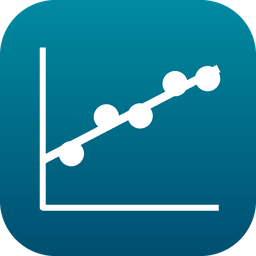

# Size-Strain Lab

**Crystallite size and microstrain from X-ray line broadening -
Williamson-Hall and size-strain plots, dislocation density, a broadening calculator.**

[](https://github.com/bolevin/size-strain-lab-demo/actions/workflows/ci.yml)


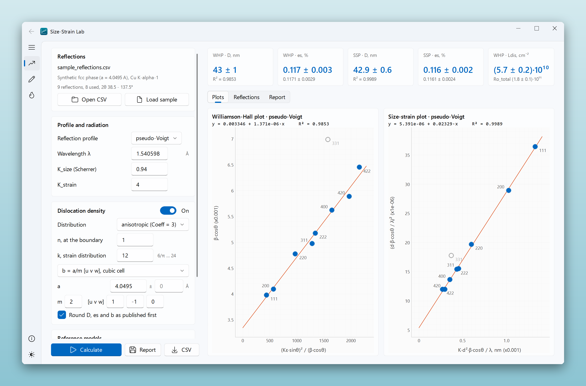

</div>

A demonstration, written from scratch, of the method of **SizeOut** - the program of the
SizeCr package by A. A. Levin that turns the widths of powder-diffraction lines into the
size of the crystallites and the strain inside them. The demo is small in scope and
built the way a scientific desktop program should be: a pure calculation core, ports and
adapters, a passive view, decisions written down, and numbers that are checked four
independent ways.

## Highlights

- **Two plots, three profiles, side by side.** The Williamson-Hall plot and the
  size-strain plot of the same reflections, for Lorentz, Gauss or pseudo-Voigt profiles,
  each with its line, R², D and es with e.s.d.'s.
- **Click a point to leave it out.** The fit, the cards, the table and the report update
  at once.
- **Degenerate lines handled the way the method's author prescribes.** No strain → D from
  the Scherrer or Monshi model (two models, two solutions); no size broadening → es from
  the Stokes-Wilson model.
- **Dislocation density** after Williamson & Smallman and after Ashby, with the Burgers
  vector typed in or computed for a cubic cell, optionally from D, es and b rounded as
  they would be published.
- **A calculator** from D and es to the broadening of one reflection - and back, from the
  widths or from the densities.
- **Report and CSV** for every calculation; light and dark theme.

## Screenshots

| | |
|:---:|:---:|
| 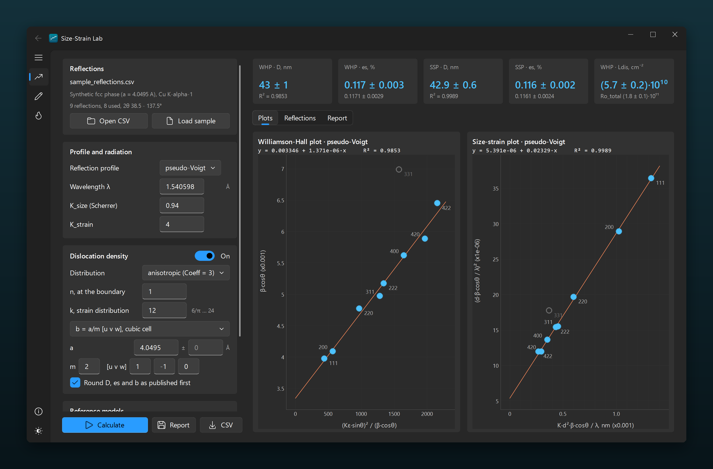 | 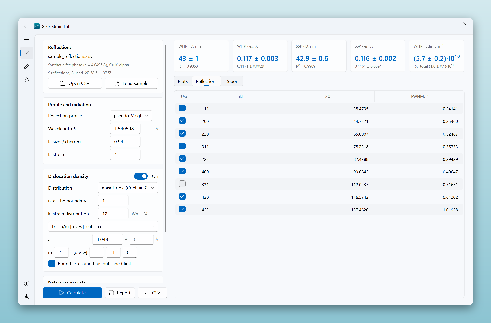 |
| The fit, dark theme - the excluded 331 reflection is hollow | The reflections; a check box refits at once |
| 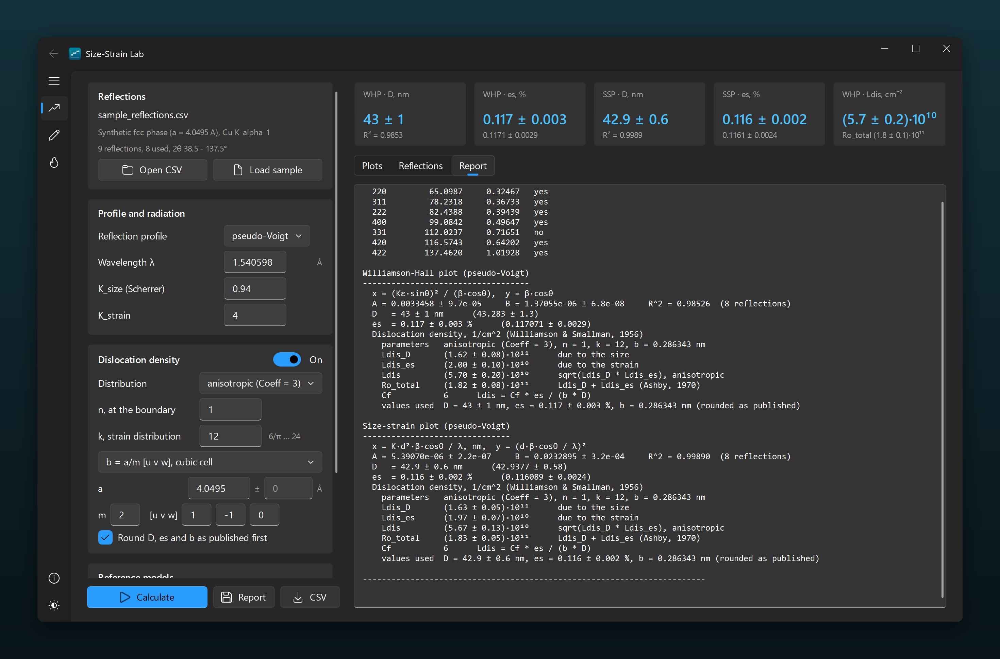 | 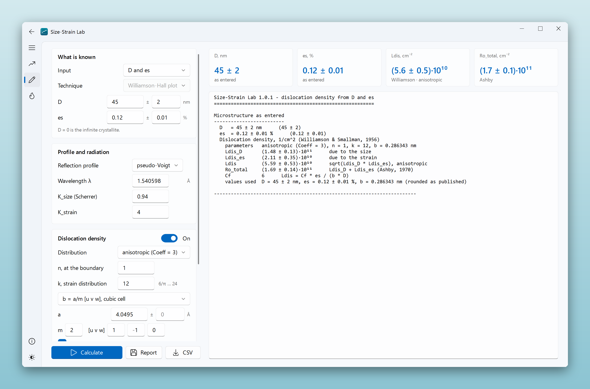 |
| The report: full precision and published rounding | From D and es: Williamson-Smallman and Ashby densities |
| 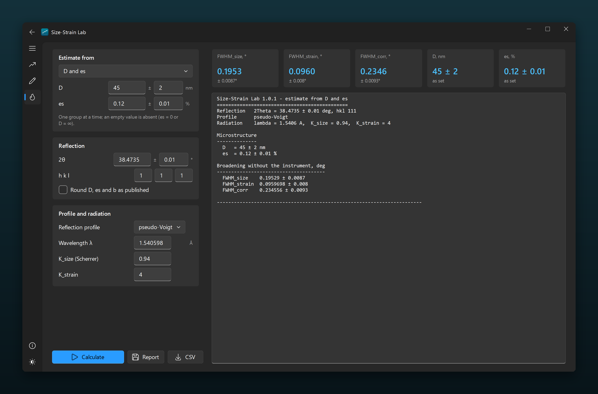 | |
| The calculator: widths of the 111 reflection from D and es | |

### The full program

The demo is the small sibling of **SizeOut 16.01**, the full program it was written after.
Same sample, same numbers: the D = 43.283 nm and es = 0.117071 % below are the values in
the demo's report, which its first cards round to 43 ± 1 nm and 0.117 ± 0.003 %.

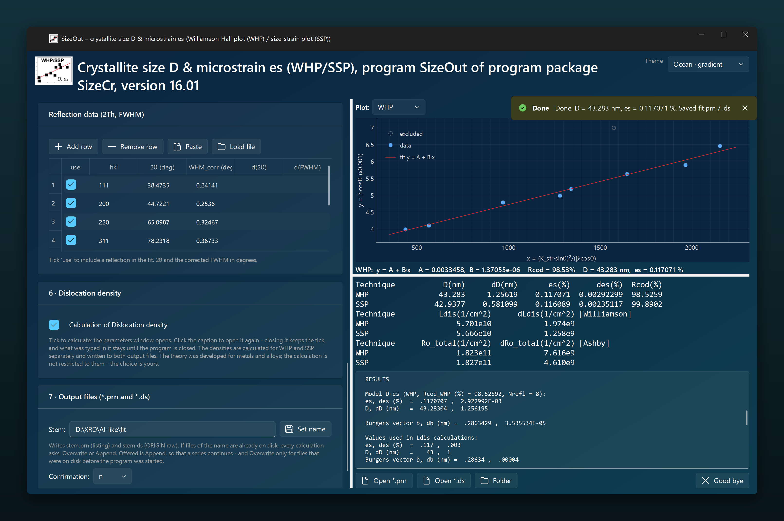

| | |
|:---:|:---:|
| 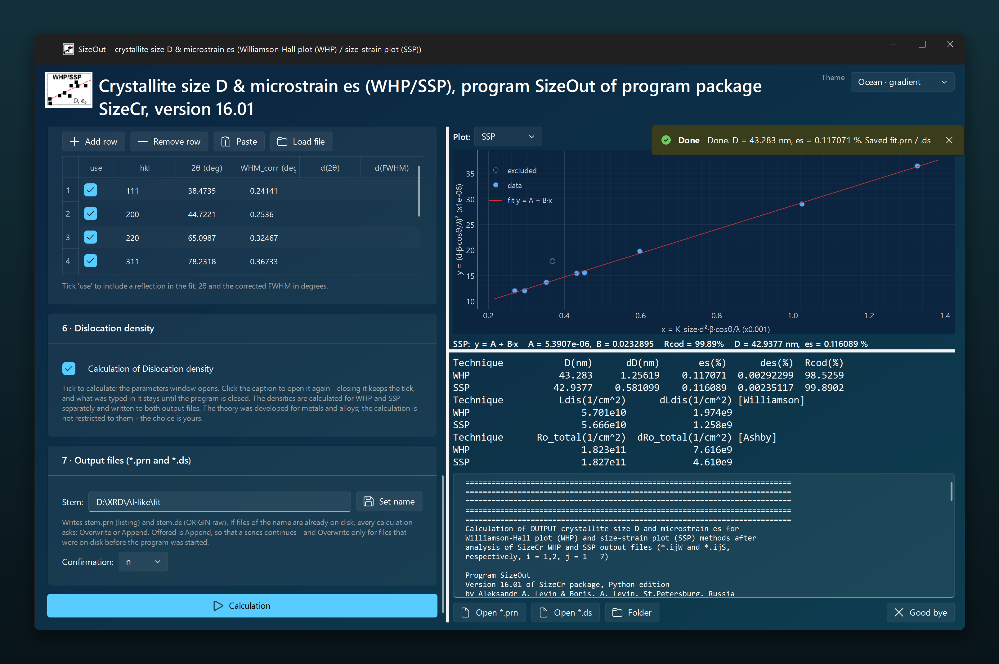 | 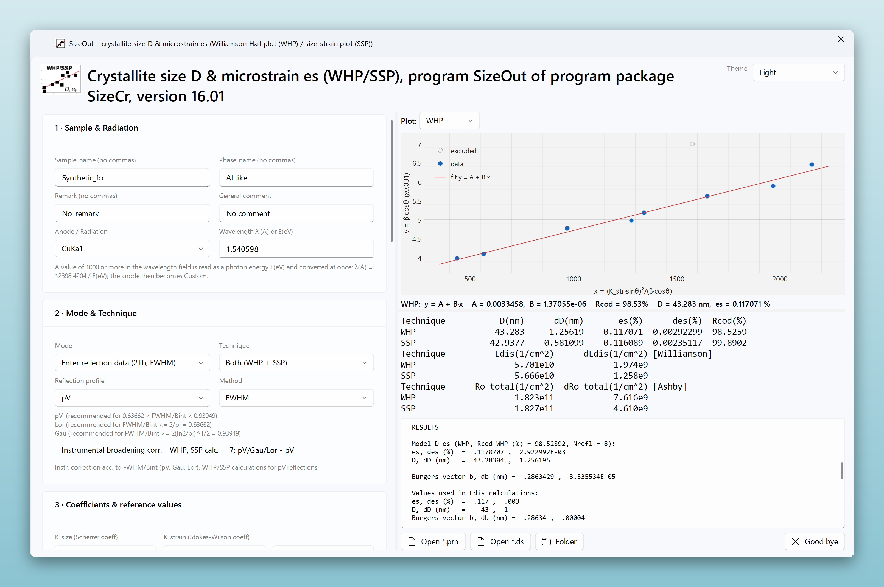 |
| Size-strain plot, Ocean theme | Light theme, the listing open at its results |
| 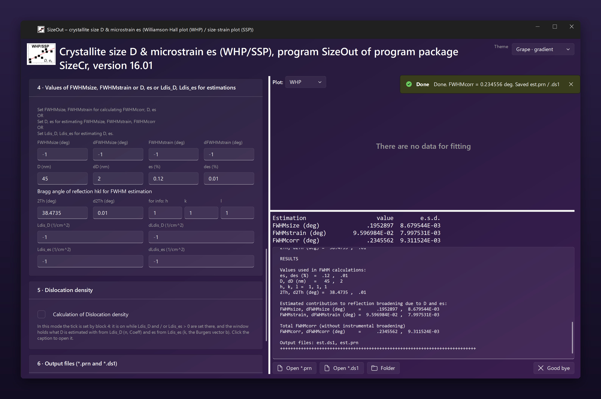 | 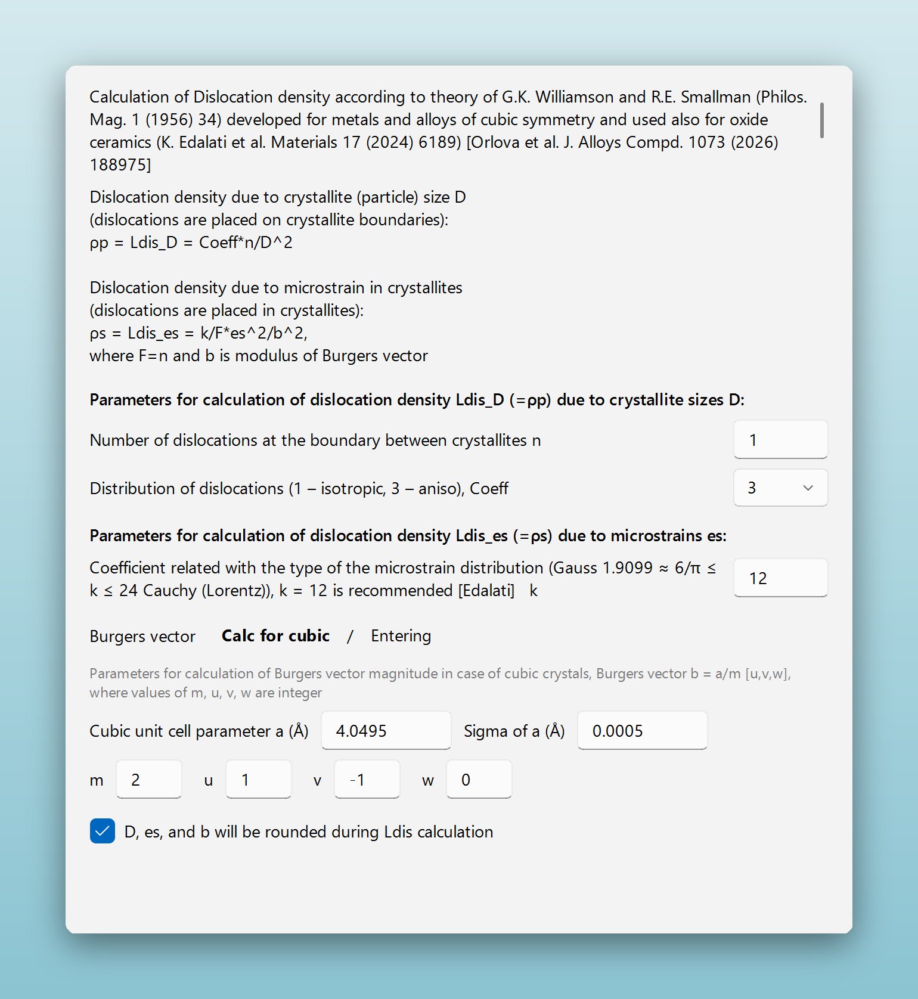 |
| The calculator, Grape theme | The dislocation window: theory and parameters |

| | Demo (this repository) | Full program |
|---|:---:|:---:|
| WHP and SSP, Lorentz / Gauss / pseudo-Voigt | ✓ | ✓ |
| Fit of reflections, line typed in, two reflections, D and es typed in | ✓ | ✓ |
| Reference models (Scherrer, Monshi, Stokes) | ✓ | ✓ |
| Dislocation density (Williamson-Smallman, Ashby), published rounding | ✓ | ✓ |
| Broadening calculator in three directions | ✓ | ✓ |
| Reads the output of SizeCr (`*.ijW`, `*.ijS`) | | ✓ |
| Listing and data files byte for byte as the QuickBASIC original, single precision | | ✓ |
| Series of calculations appended to one listing | | ✓ |
| Seven colour themes, sample and instrument metadata, FWHM / Bint methods | | ✓ |
| Arithmetic | double | single, as the original |

## Quick start

```bash
git clone https://github.com/bolevin/size-strain-lab-demo
cd size-strain-lab-demo
python -m venv .venv && .venv\Scripts\activate
pip install -e .
python -m sizeout_demo
```

Press **Load sample**, switch **Dislocation density** on, press **Calculate**. Then click
the hollow point of the 331 reflection and watch the fit change.

A Windows executable is attached to each [release](https://github.com/bolevin/size-strain-lab-demo/releases)
together with its source. `SizeStrainLab.exe --selftest` checks a build without opening
a window.

Your own data: a CSV with a header row.

```text
# title: My sample, Cu K-alpha-1
h,k,l,two_theta,fwhm,use
1,1,1,38.4735,0.24141,1
2,0,0,44.7221,0.25360,1
```

`two_theta` and `fwhm` (degrees, the width already corrected for the instrument) are
required; `h,k,l` and `use` are optional; comma, semicolon or tab separate the fields.

## How it works

A small crystallite widens a line as 1/cos θ, a strained lattice as tan θ:

$$
\beta_D = \frac{K\lambda}{D\cos\theta}, \qquad \beta_\varepsilon = K_\varepsilon\thinspace  e\tan\theta .
$$

Each plot rearranges their sum - which depends on the profile - into a straight line
y = A + Bx, so that D comes from one coefficient and e from the other. For example, the
pseudo-Voigt Williamson-Hall plot:

$$
\beta\cos\theta = \frac{K\lambda}{D} + e^2\thinspace \frac{(K_\varepsilon\sin\theta)^2}{\beta\cos\theta}.
$$

All six linearizations, the uncertainties, the reference models, the densities and the
rounding rules are in **[docs/theory.md](docs/theory.md)**.

## How the numbers are verified

A test that cannot fail proves nothing, so the evidence comes in four independent layers:

| Layer | What it shows | Size |
|---|---|---|
| **Golden master** | The same inputs through the full SizeOut 16.01 give the same results - A, B, R² to 12 digits, D, es, densities and widths to 7 (the full program stores single precision) | 63 cases: the sample fit, 42 lines with reference models, densities, the calculator, rounding |
| **Properties** (`hypothesis`) | Widths made from a known D and es return that D and es through **each** of the six plots, for any D, es, angles and wavelength; the calculator's equations invert each other; Ldis lies between its parts | 9 properties, hundreds of examples each |
| **Worked examples** | Sums done by hand: a four-point least-squares fit, the line through two points, the published-rounding examples, the method author's own density table | 70+ tests |
| **Mutations** | 17 planted bugs - a dropped factor 4, a tangent in the wrong place, half-even rounding, a NumPy import in the core, a toggle that forgets to refit - each turns the suite red | `tools/mutation_check.py`: 17 of 17 caught |

The property tests found two things on the way: the Lorentz size-strain plot needs
cos θ in its y-axis to be exactly linear ([ADR 6](docs/adr/0006-exact-lorentz-size-strain-plot.md)),
and the published-rounding rule for es is not idempotent at a carry - 0.995 ± 0.045
rounds to 1.0 ± 0.05, which rounds again to 1.0 ± 0.1. The second is a property of the
rule itself; the test that records it says so.

## Architecture

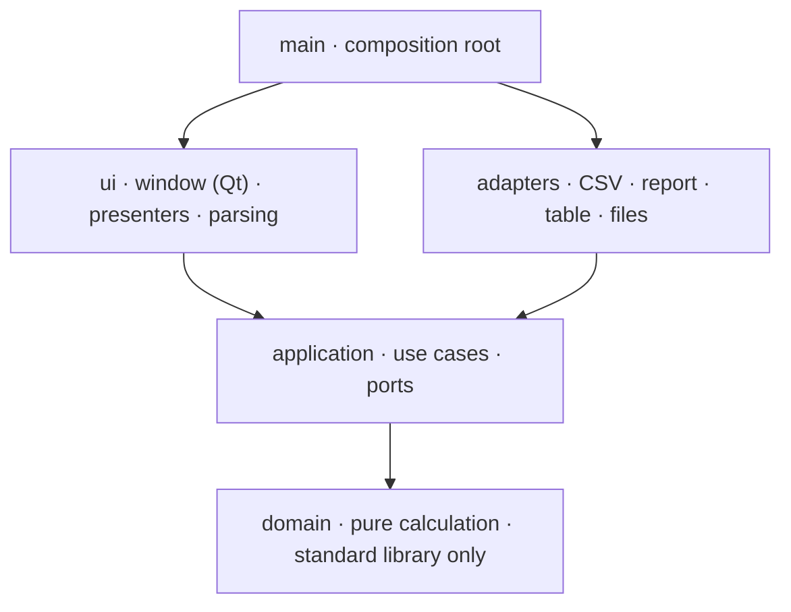

- **Ports and adapters.** The domain is frozen dataclasses and pure functions with no I/O,
  no Qt, no NumPy. The application owns the ports (`typing.Protocol`); adapters implement
  them; `main` wires them together.
- **Model-View-Presenter, passive view.** The window hands over what was typed and draws
  what it is given. Presenters, parsing and view contracts import no Qt, so every user
  intent is tested in plain Python against a fake window.
- **Strategy.** One small class per technique and profile; the round-trip test iterates
  over the registry.
- **The rules are tests.** `import-linter` contracts keep the dependencies pointing inwards;
  an AST test checks that every value object is frozen.

Read **[docs/architecture.md](docs/architecture.md)** (arc42: context, building blocks,
runtime, quality scenarios each tied to the test that holds it, risks), the
**[decision records](docs/adr/)** and the **[glossary](docs/glossary.md)**.

## Development

```bash
pip install -e .[dev]
pytest                              # 215 tests
ruff check src tests tools && ruff format --check src tests tools
mypy                                # strict
lint-imports                        # the architecture contracts
python tools/mutation_check.py      # every planted bug must be caught
python tools/make_screenshots.py    # regenerate docs/img/demo-*.png
python tools/make_sample.py         # regenerate the synthetic sample
```

`tools/make_golden.py` re-records the golden master; it needs the full program, which is
not part of this repository.

<details>
<summary>Project layout</summary>

```text
src/sizeout_demo/
  domain/        quantity, instrument, reflection, regression, linearization,
                 microstructure, dislocations, estimation, rounding, analysis
  application/   service (use cases), ports, runs, formatting
  adapters/      csv_reflections, text_report, csv_table, files
  ui/            presenters, parsing, view (no Qt) - pages, widgets, plot, main_window (Qt)
  main.py        composition root
  data/          sample_reflections.csv, icon
tests/           domain, adapters, application, ui, architecture, golden/
tools/           make_sample, make_golden, make_screenshots, make_icon, mutation_check
docs/            architecture.md (arc42), adr/, theory.md, glossary.md, img/
```

</details>

## Citing

If you use this program, please cite it ([CITATION.cff](CITATION.cff)) and the method:
A. A. Levin, *SizeCr program package*, DOI
[10.13140/RG.2.2.15922.89280](https://doi.org/10.13140/RG.2.2.15922.89280).

## Authors and licence

**Boris A. Levin** ([@bolevin](https://github.com/bolevin)) - design and implementation of
this demo.
**Aleksandr A. Levin** - the method and the original program SizeOut of the SizeCr
package.

Free software under the [GNU General Public License v3.0 or later](LICENSE); the licences
of the libraries it uses are in [THIRD-PARTY-NOTICES.md](THIRD-PARTY-NOTICES.md). The
sample data are synthetic.
