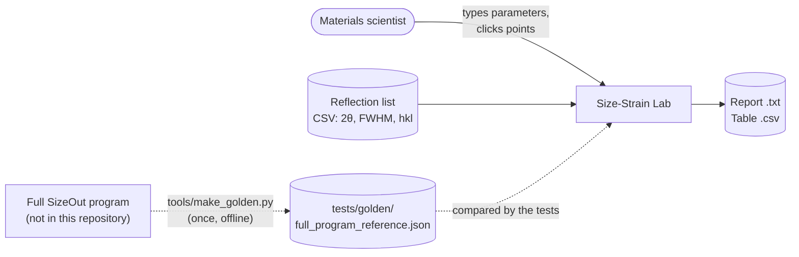
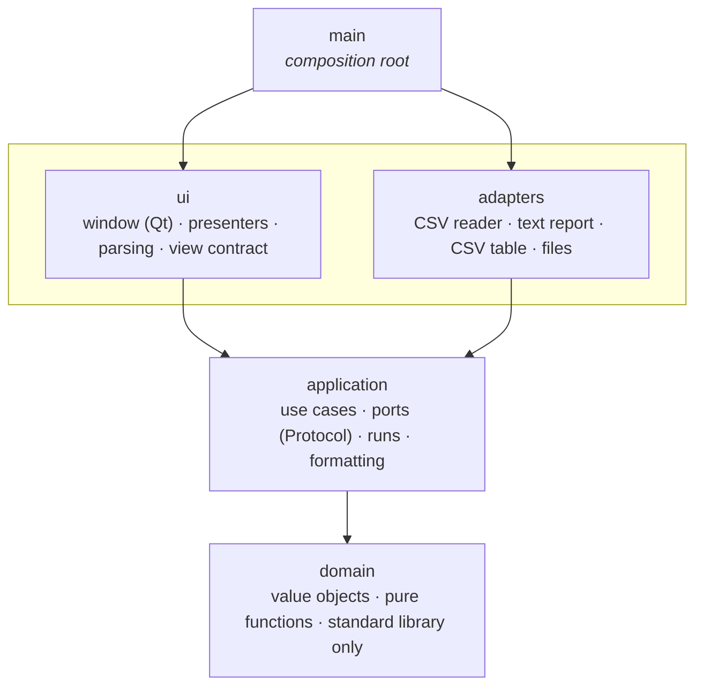
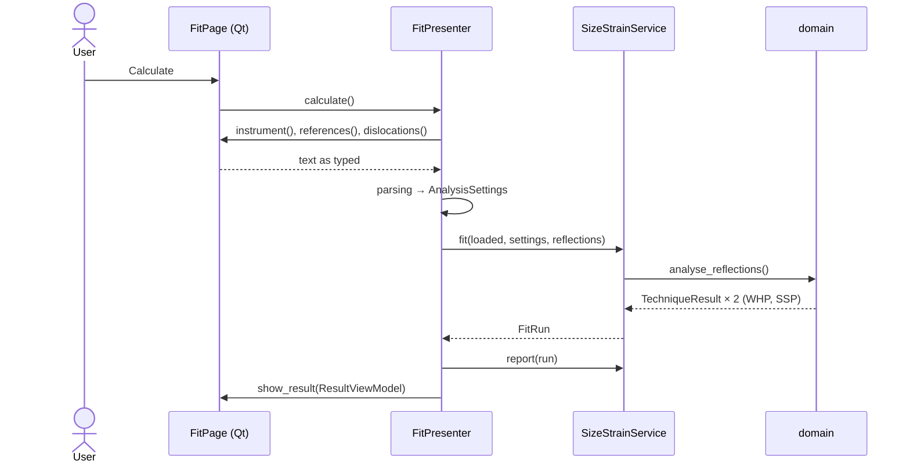
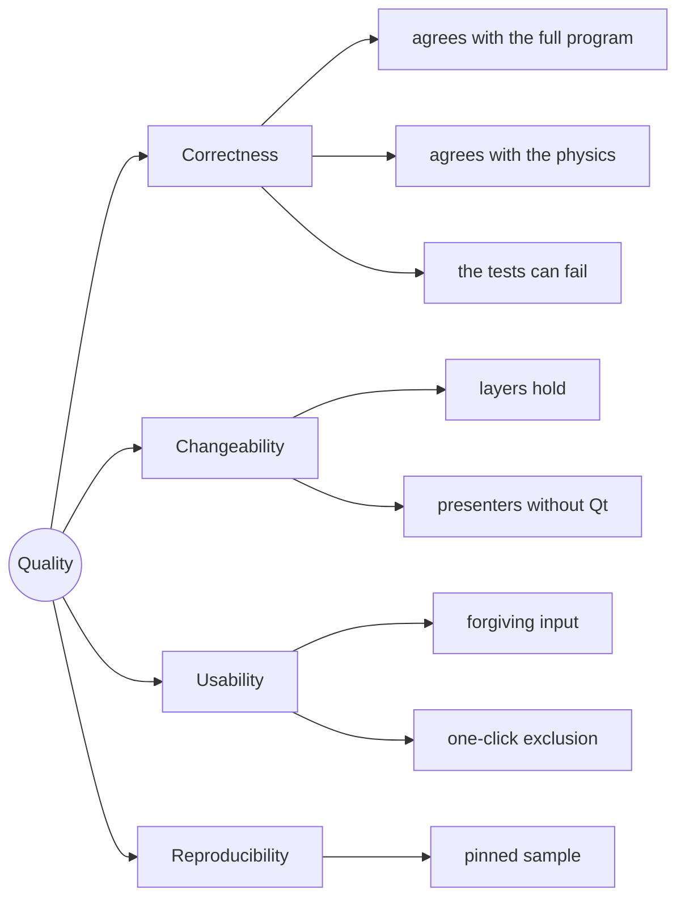

# Size-Strain Lab - architecture

Structured after [arc42](https://arc42.org) (lean). Diagrams are Mermaid and render on
GitHub. Every quality goal in section 10 names the test that holds it.

---

## 1. Introduction and goals

### 1.1 Requirements overview

Size-Strain Lab estimates the **crystallite size D** and the **microstrain e** of a
polycrystalline material from the widths of its X-ray diffraction lines, and from them
the **dislocation density**. It is a demonstration, written from scratch, of the method
of the program SizeOut by A. A. Levin.

| # | The user can | Where |
|---|---|---|
| F1 | load a list of reflections (CSV) or the bundled synthetic sample | Fit page |
| F2 | fit Williamson-Hall and size-strain plots side by side, for Lorentz, Gauss or pseudo-Voigt profiles, with e.s.d.'s and R² | Fit page |
| F3 | leave a reflection out of the fit by clicking its point or its check box, and see the fit update at once | Fit page |
| F4 | get D and e from a line typed in, from a line through two reflections, or type D and e in | From a line |
| F5 | fall back on reference models (Scherrer, Monshi, Stokes) when the line shows no strain or no size broadening | Fit, From a line |
| F6 | compute dislocation densities (Williamson-Smallman, Ashby), optionally from D, e, b rounded as published | all pages |
| F7 | estimate the broadening of one reflection from D and e - and D, e from widths or densities | Calculator |
| F8 | save a text report and a CSV table of every result | all pages |

### 1.2 Quality goals

| Priority | Goal | In one sentence |
|---|---|---|
| 1 | **Correctness** | The numbers agree with the full program and with the physics, and every check is shown to fail when the code is wrong. |
| 2 | **Changeability** | The calculation does not know about files or windows; a new format, plot or front end touches one layer. |
| 3 | **Usability** | Inputs are forgiving (decimal comma, empty = not set), errors name the field, results are rounded as they would be published. |
| 4 | **Reproducibility** | The sample, the golden numbers and the screenshots are made by scripts with fixed inputs. |

### 1.3 Stakeholders

| Who | Expects |
|---|---|
| A materials scientist | correct D, e and densities with honest uncertainties, a report to paste into a lab book |
| A reviewer of the code | a structure that can be read in an hour, decisions written down, tests that prove something |
| The author of the method | his equations implemented as written, the differences named |

## 2. Constraints

| Constraint | Consequence |
|---|---|
| Windows 11 desktop, Python ≥ 3.11 | PySide6; a PyInstaller build on release |
| Same look as the full program | PySide6-Fluent-Widgets, which is GPL-3.0 → the demo is GPL-3.0-or-later ([ADR 8](adr/0008-fluent-widgets-and-gpl.md)) |
| The full program is not published | its numbers enter only as a recorded golden file ([ADR 5](adr/0005-double-precision-and-a-golden-master.md)) |
| Example data must be shareable | a synthetic sample generated by `tools/make_sample.py` |

## 3. Context and scope

The widths are expected **already corrected** for the instrument; separating the
instrumental profile is the job of the program that measured them.

## 4. Solution strategy

| Goal | Approach |
|---|---|
| Correctness | four independent layers of evidence: hand-worked examples, a golden master from the full program, property tests (`hypothesis`), and a mutation check that plants known bugs |
| Changeability | ports and adapters with a standard-library core ([ADR 2](adr/0002-ports-and-adapters.md)); one strategy per plot ([ADR 4](adr/0004-one-strategy-per-linearization.md)) |
| Usability | Model-View-Presenter with a passive view ([ADR 3](adr/0003-mvp-passive-view.md)); parsing in one Qt-free module; published rounding in the domain |
| Reproducibility | every artefact made by a script in `tools/`; golden file pinned to the sample by SHA-256 |

## 5. Building block view

### 5.1 Level 1 - layers

Dependencies point inwards only. The rule is enforced by three `import-linter`
contracts (`pyproject.toml`):

1. `main` → `ui | adapters` → `application` → `domain`, never back;
2. `domain` and `application` import neither Qt nor NumPy;
3. `ui.presenters`, `ui.parsing` and `ui.view` import no Qt.

### 5.2 Level 2 - the domain

| Module | Responsibility |
|---|---|
| `quantity` | `Quantity(value, esd)` - the value object everything else is made of |
| `instrument` | `Instrument` (λ, K, K_ε), `Profile`, `Technique` |
| `reflection` | `Reflection` - 2θ, FWHM, hkl, in use or not |
| `regression` | least squares (`fit_line`) and the line through two points (`line_through`) |
| `linearization` | the six plots: where a reflection goes, what A and B mean |
| `microstructure` | `SizeStrain`, `ReferenceModels`, the rules for degenerate lines |
| `dislocations` | Burgers vector, Williamson-Smallman and Ashby densities |
| `estimation` | the calculator, forwards and backwards |
| `rounding` | rounding as published |
| `analysis` | the pieces put together: `analyse_reflections`, `solve` |

### 5.3 Level 2 - application, adapters, ui

| Package | Contents |
|---|---|
| `application` | `SizeStrainService` (load, fit, from a line, from two reflections, from D and e, estimate, report, export); ports `ReflectionReader`, `ReportRenderer`, `TableRenderer`, `TextStore`; the `*Run` records; `formatting` (how numbers are written for people) |
| `adapters` | `CsvReflectionReader`, `PlainTextReport`, `CsvResultTable`, `FileTextStore` |
| `ui` | `FitPresenter`, `LinePresenter`, `EstimatePresenter`; `parsing`; the view contracts; the Qt pages, widgets, plot and window |

## 6. Runtime view

### 6.1 Fit the reflections

### 6.2 Leave a reflection out

A click on a point emits `point_clicked(index)`; the table's check box does the same.
`FitPresenter.toggle(index)` flips the reflection, redraws the table and - if a result
is shown - recalculates, so the cards, the plots and the report change together.

### 6.3 A line with no strain

`solve()` reads D and e from the line; the strain coefficient is ≤ 0, so
`solutions()` takes D from each es = 0 model entered. With none entered it raises
`ReferenceModelRequired`; `solve()` turns that into a `TechniqueResult` with a
`problem` and no solutions, and the page shows a warning for that technique only.

## 7. Deployment view

| Artefact | How |
|---|---|
| Source | `pip install -e .[dev]`, `python -m sizeout_demo` |
| Windows executable | built by `.github/workflows/release.yml` on a version tag with PyInstaller, `--selftest` run on the result, published with the source archive |
| Sample data | `src/sizeout_demo/data/sample_reflections.csv`, shipped inside the package and the executable |

## 8. Crosscutting concepts

* **Value objects.** Every dataclass in `domain` and `application` is frozen
  (checked by `test_value_objects_are_immutable`) and validates itself on construction.
* **Units.** λ in Å at the edges, nm inside the equations; widths in degrees at the edges,
  radians inside; e in % at the edges. Conversions sit in one place each
  (`Instrument.wavelength_nm`, `Reflection.beta`).
* **Absent values.** `None` is "not entered", `math.inf` the infinite crystallite
  ([ADR 7](adr/0007-infinite-size-and-typed-errors.md)).
* **Errors.** Typed `DomainError`s from the domain, `InputError` from parsing; the
  presenters catch both and show the message.
* **Formatting.** `application/formatting.py` writes numbers for people - published
  rounding, ∞, powers of ten - for both the report and the window.
* **Themes.** The window follows the system light/dark theme and switches on demand;
  the plot re-applies its palette, because pyqtgraph resolves colours at draw time.

## 9. Architecture decisions

| ADR | Decision |
|---|---|
| [0001](adr/0001-record-architecture-decisions.md) | Record architecture decisions |
| [0002](adr/0002-ports-and-adapters.md) | Ports and adapters around a standard-library core |
| [0003](adr/0003-mvp-passive-view.md) | Model-View-Presenter with a passive view |
| [0004](adr/0004-one-strategy-per-linearization.md) | One strategy class per technique and profile |
| [0005](adr/0005-double-precision-and-a-golden-master.md) | Double precision, checked against the full program |
| [0006](adr/0006-exact-lorentz-size-strain-plot.md) | The Lorentz size-strain plot with cos θ |
| [0007](adr/0007-infinite-size-and-typed-errors.md) | The infinite crystallite is infinity; missing data is a typed error |
| [0008](adr/0008-fluent-widgets-and-gpl.md) | Fluent widgets, and therefore GPL-3.0 |

## 10. Quality requirements

### 10.1 Quality tree

### 10.2 Scenarios, each held by a test

| # | Scenario | Held by |
|---|---|---|
| C1 | The sample through the full program and the demo gives the same A, B, R² to 12 digits and the same D, e to 7 | `tests/domain/test_golden.py::test_fit_of_the_sample` |
| C1 | 42 lines × reference models, 4 density cases, 7 calculator cases, 16 roundings agree with the full program | `test_golden.py` (all) |
| C2 | Widths made from a known D and e return that D and e through each of the six plots, for any D, e, angles, λ | `tests/domain/test_properties.py::test_round_trip_through_every_linearization` |
| C2 | The calculator's forward and backward equations are inverses | `test_properties.py::test_calculator_round_trip` |
| C2 | Ldis lies between its parts and squares to their product; Ro_total is their sum | `test_properties.py::test_density_relations` |
| C2 | The least-squares sums match a four-point example worked by hand | `tests/domain/test_regression.py` |
| C3 | Seventeen planted bugs - a missing factor, a wrong tangent, half-even rounding, a numpy import - each turn the suite red | `tools/mutation_check.py` |
| M1 | Dependencies point inwards; the domain uses the standard library only | `tests/architecture/test_layers.py` |
| M2 | Presenters, parsing and view contracts import no Qt | `test_layers.py::test_presenters_parsing_and_view_import_no_qt` |
| U1 | "2,25" is read as 2.25; an empty e.s.d. is 0; an error names its field | `tests/ui/test_parsing.py`, `test_presenters.py::test_bad_input_clears_and_explains` |
| U2 | A click on a point or a check box refits at once | `test_presenters.py::test_toggling_a_point_refits`, `tests/ui/test_window.py::test_a_click_on_a_point_refits` |
| R1 | The golden file belongs to the bundled sample | `test_golden.py::test_the_reference_was_made_from_this_sample` |

## 11. Risks and technical debt

| Item | Note |
|---|---|
| The golden master is single precision | Comparisons are at 3·10⁻⁷; a regression smaller than that would pass. The hand examples and the property tests work at 10⁻⁹. |
| Widths must be instrument-corrected | The demo does not deconvolve; wrong input widths give wrong D and e without warning. |
| The window tests are slow | Each Fluent window takes seconds to build off screen; they are few on purpose. |
| Lorentz SSP differs from the full program | Deliberate and documented ([ADR 6](adr/0006-exact-lorentz-size-strain-plot.md)). |

## 12. Glossary

See [glossary.md](glossary.md).
